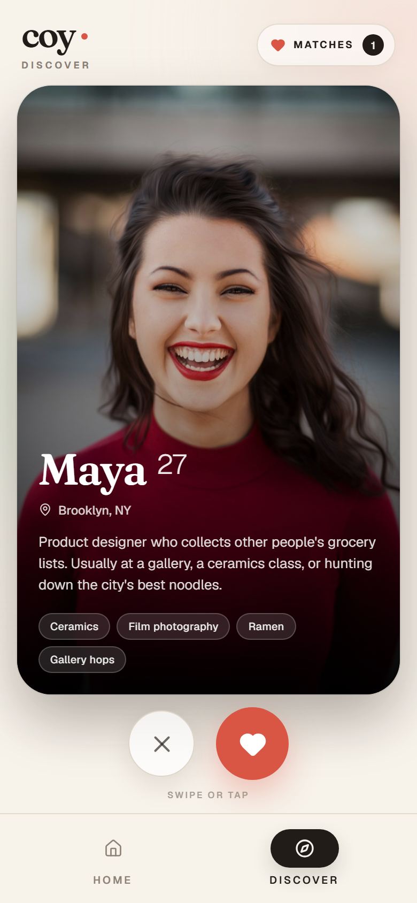
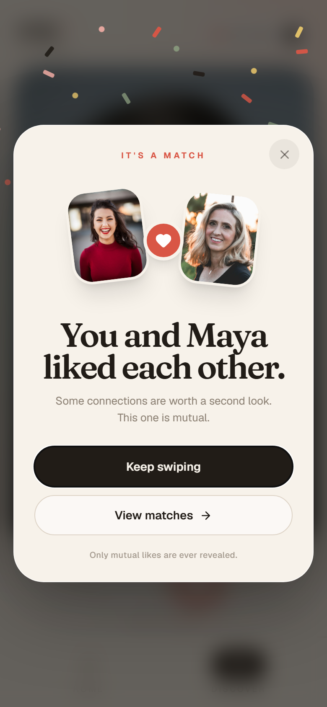

# Coy Discover

A mobile-first, swipe-to-discover experience built as a standalone Next.js app. The app keeps Coy's core promise intact: you only see a match when the feeling is mutual.

The existing experience is represented by a deliberately blank **Home** tab. All discovery functionality lives in **Discover**.

<table>
  <tr>
    <td></td>
    <td></td>
    <td></td>
  </tr>
  <tr>
    <td align="center"><sub>Discover</sub></td>
    <td align="center"><sub>Mutual match</sub></td>
    <td align="center"><sub>Matches</sub></td>
  </tr>
</table>

## Features

- 50 seeded profiles with names, ages, local placeholder portraits, bios, cities, colleges, and interests
- One profile card at a time with the next card layered behind
- Touch/mouse drag gestures with rotation, threshold detection, and LIKE/NOPE feedback
- Desktop-friendly pass/like buttons and keyboard support (`←` / `→`)
- Smooth exit animations, toast feedback, loading, error, and empty states
- Match only when both people have liked each other
- Full-screen "It's a match!" moment with confetti
- Matches view containing mutual matches only
- Persistent swipes and matches through a server-side JSON store
- Privacy-by-design API: incoming likes are never exposed

## Demo flow

1. Run the app and open **Discover**.
2. Swipe right on the first card. That profile is one of the seeded users who has already liked the current user, so the first right swipe demonstrates the match screen.
3. Open **Matches** from the header to see both the new match and one pre-existing mutual match.
4. Reload the page — the deck and matches retain their state.

Reset the demo at any time:

```bash
npm run seed
```

## Tech stack

- **Next.js 16** (App Router, Route Handlers)
- **React 19 + TypeScript**
- **Tailwind CSS 4**
- **Framer Motion** for gesture and card animations
- **Lucide** icons
- **JSON file persistence** with atomic writes and a serialized write queue
- **Vitest** for data-store tests

## Getting started

Requires Node.js 20.9+ (tested on Node 24).

```bash
npm install
npm run dev
```

Open [http://localhost:3000](http://localhost:3000).

Production check:

```bash
npm run build
npm run start
```

## API

All endpoints are root-level Route Handlers. The current user is fixed server-side; no authentication is required.

### `GET /feed`

Returns profiles the current user has not swiped on.

```json
{
  "profiles": [
    {
      "id": "p01",
      "name": "Maya",
      "age": 27,
      "photo": "/profiles/p01.jpg",
      "bio": "Product designer...",
      "city": "Brooklyn, NY",
      "interests": ["Ceramics", "Film photography"]
    }
  ]
}
```

### `POST /swipe`

Records a swipe and creates a match only when the target already liked the current user.

```json
{
  "profileId": "p01",
  "direction": "like"
}
```

```json
{
  "matched": true,
  "match": {
    "id": "match_...",
    "matchedAt": "2026-11-19T12:00:00.000Z",
    "profile": { "id": "p01", "name": "Maya" }
  }
}
```

Returns `409 already_swiped` for duplicate swipes and `404 not_found` for unknown profiles.

### `GET /matches`

Returns mutually matched profiles, newest first.

```json
{
  "matches": [
    {
      "id": "match_...",
      "matchedAt": "2026-11-19T12:00:00.000Z",
      "profile": { "id": "p01", "name": "Maya" }
    }
  ]
}
```

Response shapes are typed in [`lib/types.ts`](lib/types.ts).

## Persistence

- [`data/seed.json`](data/seed.json) is the checked-in seed dataset.
- On first request, the app creates `data/db.json` from the seed.
- Every swipe/match mutation is written atomically via a temporary file and rename.
- Mutations are serialized to prevent lost updates from concurrent requests.
- `data/db.json` is gitignored and can be reset with `npm run seed`.

This local JSON store is appropriate for the assignment demo. It is not a good fit for a serverless deployment with an ephemeral filesystem; that would require an external database.

## Privacy model

- Incoming likes live only in the server-side store.
- No endpoint exposes who liked the current user, or which profiles are incoming likes.
- The feed payload contains profile data only.
- A match is created only inside the `like` mutation after checking the hidden incoming-like set.
- `/matches` contains mutual matches only.

## Project structure

```text
app/
  discover/          Discover page
  feed/route.ts      GET /feed
  swipe/route.ts     POST /swipe
  matches/route.ts   GET /matches
  page.tsx           Blank Home tab
components/
  discover/          Swipe deck, cards, match moment, matches view
  BottomNav.tsx
data/
  seed.json          Seed database
lib/
  store.ts           Persistent data store
  store.test.ts      Store tests
  types.ts
  current-user.ts
scripts/
  fetch-profile-images.mjs
  reset-data.mjs
docs/                README screenshots
```

## Verification

```bash
npm test       # 8 store tests
npm run lint
npm run build
```

The test suite covers feed filtering, mutual matching, pass behavior, hidden incoming likes, duplicate swipes, unknown profiles, concurrent writes, and persistence across store instances.

## Image credits

Portrait placeholders are sourced from [Unsplash](https://unsplash.com) and stored locally in `public/profiles/` for reliable offline demos. Source photo IDs are listed in [`scripts/fetch-profile-images.mjs`](scripts/fetch-profile-images.mjs).
